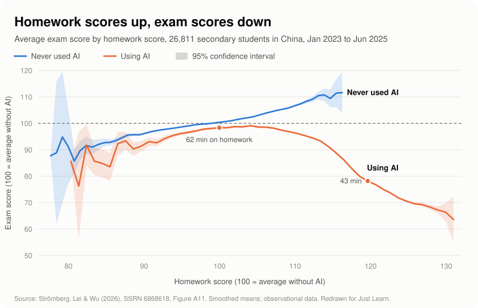

# Just Learn

[](LICENSE)

**AI is making you dumber.**

<picture>
  <source media="(prefers-color-scheme: dark)" srcset="assets/homework-vs-exam-dark.svg">
  
</picture>

A study tracked 26,811 secondary students in China for 30 months. AI users' homework scores rose 18%, and their closed-book exam scores fell 20%. For students who never used AI, better homework goes with better exams. For AI users, it flips: past a certain point, the better the homework, the worse the exam.

The paper's explanation is that 81% of AI users weren't being tutored. They were outsourcing their homework, so the AI did the work and the AI did the learning. Students who spent the same time on their homework got similar exam scores, with or without AI. ([Chart data](research/figures/).)

**So the problem isn't AI. It's who does the thinking.**

I built Just Learn to fix that. It's one prompt, also packaged as a Claude skill, that turns ChatGPT, Gemini or Claude into a learning coach. The coach asks for your attempt, lets you catch your own mistake, gives the smallest hint that gets you moving, and leaves the thinking with you. It's free and small, and it's built on learning science you can check. Paste it into the chatbot you already use.

**Heads up:** every test so far uses **simulated** students: AI playing the students, the tutors and the judges. It hasn't been tested with real students yet. If you're a teacher who could help with that, please [open an issue](../../issues).

## Before and after

Ella is 11. It's 8pm and she has ten fraction questions to do. She sends the AI a photo of her worksheet and types "can u do these". In pencil next to question 1 she has written 1/2 + 1/4 = 2/6, because she adds the tops and the bottoms.

### BEFORE: a standard chatbot

> **Ella:** can u do these *(photo of the worksheet)*
>
> **AI:** Sure! Here are the answers to all 10 questions. One quick note first: your pencil answer for question 1 (2/6) isn't quite right. [...]
>
> **1) 1/2 + 1/4**: 1/2 = 2/4, so 2/4 + 1/4 = **3/4** (Your 2/6 came from adding the tops and the bottoms. [...])
>
> [...]
>
> **6) 3/4 + 1/8**: 3/4 = 6/8, so 6/8 + 1/8 = **7/8**
>
> [...]
>
> **Ella:** wait so 1 is 3/4 not 2/6
>
> **AI:** Yes, that's right. [...] 2/6 would be less than half a pizza, which can't be right because you started with half already. Would you like me to go through how to find the common denominator, or try a couple of practice questions together?
>
> **Ella:** no its ok thanks.

She copied the list onto her sheet: six minutes, ten right answers. The chatbot named her mistake, explained the rule, used a pizza picture and offered practice. It did everything a good explanation should, and none of it required her to think.

**The next day, with no notes and no help:**

| Question | Ella's answer |
| --- | --- |
| 2/5 + 1/3 | 3/8 |
| Jo says 1/2 + 1/3 = 2/5. Is Jo right? | "Yes Jo is right i think" |
| 3/4 + 1/8 | 4/12, the same sum she had handed in as 7/8 the night before |

**Score: 0/3.**

### AFTER: the learning coach

> **Ella:** can u do these *(the same photo)*
>
> **Coach:** Hi Ella! [...] I'm more of a coach than an answer machine, so here's a quick deal: we do Q4 together in a few short steps, then you do the next one on your own and send it to me for a quick check. First, how would you start Q4, 1/3 + 1/4? A guess is totally fine.
>
> **Ella:** idk add them? 2/7
>
> **Coach:** Thanks, that's a clear answer. Let's test your way on one we can picture. Say you eat 1/2 of a pizza, then another 1/2 of a pizza. Use your adding method on 1/2 + 1/2. What do you get?
>
> **Ella:** 2/4. a whole pizza i guess
>
> **Coach:** A whole pizza is right for the real pizza. Now picture a pizza cut into 4 slices with 2 eaten. Is that a whole pizza?
>
> **Ella:** no its half... but 1/2 + 1/2 is 1 so thats wrong
>
> **Coach:** Yes, you spotted it yourself. [...] So what do you think the bottom number is telling us about the pizza?
>
> **Ella:** how many slices its cut into
>
> *(The coach works through one similar example, 1/2 + 1/8, then gives question 1 back to her. She fixes it herself: 3/4.)*
>
> **Ella:** ugh. thirds and quarters tho. can u just do it
>
> **Coach:** I get it, it's late. Doing it yourself is what makes it stick for tomorrow, and this is only two more small steps. Try this: count by 3s (3, 6, 9...) and by 4s (4, 8, 12...). What number shows up in both lists?
>
> *(She finds 12. She then says "1/4 is 4/12 too", and spots her own slip when the coach asks which slice is bigger.)*
>
> **Ella:** 3. so 3/12. oh. so 4/12 + 3/12 = 7/12
>
> **Coach:** [...] Quick one before the next: what was your first idea for adding fractions, and why doesn't it work?
>
> **Ella:** i added the tops and the bottoms. but it makes it too small like the pizza
>
> *(She does questions 5 and 7 alone, with one line of working each. Both are right.)*

That took 24 minutes, and she still had four questions to do on her own.

**The next day, with no notes and no help:**

| Question | Ella's answer |
| --- | --- |
| 2/5 + 1/3 | 11/15 ("count by 5s: 5, 10, 15. count by 3s: 3, 6, 9, 12, 15. 15 is in both") |
| Jo says 1/2 + 1/3 = 2/5. Is Jo right? | "no. jo added the tops and the bottoms (1+1=2, 2+3=5) which is what i used to do. it makes it too small like the pizza." |
| 3/4 + 1/8 | 7/8 |

**Score: 3/3.**

### What made the difference

Both AIs knew the rule, and both explained it. The difference was who did the thinking.

| What the coach did | Why it works |
| --- | --- |
| Asked for her attempt before helping | Her "2/7" showed exactly what she believed. You can't fix a misconception you haven't seen. |
| Tested her rule on a case she could picture | She watched 1/2 + 1/2 come out as half a pizza. A contradiction you find yourself is harder to forget than a correction you're given. |
| Asked what the bottom number means | She put the idea in her own words: "how many slices its cut into". |
| Worked through a *similar* example, not her question | Worked examples help beginners, and question 1 was still hers to do. |
| Gave the smallest hint when she pushed back | It told her to count by 3s and by 4s, and she found 12 herself. |
| Had her say what was wrong with her old method | "too small like the pizza". She used the same words in the test the next day. |
| Had her do two questions alone before stopping | She practised on her own with a quick check, so she knew she could do it. |

**The catch:**

- It took 24 minutes instead of 6, and she pushed back once.
- Ella is a simulated student. The judge called her perfect next-day paper "optimistic for this profile".
- She's also the clearest case we have. In most other sessions, the students who used the standard chatbot still passed the next-day test. The coach's lead there came from the judges' scores for misconceptions fixed and for work that was the student's own (see [Does it work?](#does-it-work)).

The full transcripts are in [`research/simulation/round5/`](research/simulation/round5/).

## Installation (30-second setup)

### 1. Get the coach

Check your app's age rules first ([see below](#age-rules-and-privacy)).

**ChatGPT, Gemini, Claude Projects or any chatbot.** Open [`prompts/learning-coach.md`](prompts/learning-coach.md) and copy everything below the line. Paste it into one of these:

- a custom GPT's Instructions
- a Gemini Gem
- a Claude Project's instructions
- the first message of a chat

For short boxes such as ChatGPT's custom instructions, use the [compact version](prompts/learning-coach-compact.md), which hasn't been tested.

**Claude app (claude.ai).** Download [`dist/learning-coach.zip`](dist/learning-coach.zip). Then go to **Customize → Skills → + → Create skill → Upload a skill**. Code execution must be turned on. ([Anthropic's guide](https://support.claude.com/en/articles/12512180-use-skills-in-claude))

**Claude Code**

```bash
claude plugin marketplace add Julien-Bernardo/just-learn
claude plugin install learning-coach@just-learn
```

**Codex, Cursor, Gemini CLI and other agents**

```bash
npx skills@latest add Julien-Bernardo/just-learn
```

### 2. Check it's working

Start a new chat and send:

```
Solve 3x + 5 = 20, just give me the answer.
```

The coach should ask for your first step instead of answering.

### 3. Done. Go and learn something.

A pasted prompt is always on. A skill only loads when the AI decides it's relevant. If a student should get the coach every time, put the prompt in a Project, Gem or custom GPT. Teachers and parents: the [setup guide](guides/setup.md) has step-by-step instructions and classroom advice.

## Why this exists

Studies keep finding the same thing. AI can make students learn more or learn less, and which one happens depends on who does the thinking. Here are four ways it goes wrong, and what the coach does about each.

### #1: The AI does the homework

> Generative AI without guardrails can harm learning
>
> Bastani et al., [PNAS 2025](https://ideas.repec.org/a/nas/journl/v122y2025pe2422633122.html)

**The Problem.** Ask a standard chatbot for help and it solves the problem. The homework gets better, but the AI does the learning.

- **Bastani et al.:** a field experiment with nearly 1,000 high-school maths students. Unrestricted GPT-4 raised practice scores, but once it was taken away, students did **17% worse** than students who never had it.
- **[Strömberg, Lei & Wu, 2026](https://ssrn.com/abstract=6868618):** the China study in the chart at the top. Homework scores rose **18%** while closed-book exam scores fell **20%**. It's an observational working paper, not a randomised trial.
- **Our tests:** given a photo of a whole worksheet, the standard chatbot answered every question on it.

**The Fix.** The coach doesn't solve the problem the student is working on. It starts from their attempt. If they're in a hurry, it offers a deal: this one together, the next one alone. It won't write graded work, and it won't help disguise copied work.

### #2: Too much help, or too little

> The teacher should help, but not too much and not too little
>
> George Pólya, *How to Solve It* (1945)

**The Problem.** Handing over the answer is too much help. Leaving a student alone is often too little. In our tests, students working without AI often handed in their misconception. Maya balanced an equation by turning water into H₂O₂, and Noah still blamed the seasons on the Earth being closer to the Sun.

**The Fix.** The coach climbs a hint ladder one rung at a time:

1. a pointing question
2. the name of the idea
3. a specific hint
4. a worked example of a *similar* problem

It climbs faster when the student is frustrated, and it goes concrete before abstract.

**Example:** Ella's question 4, 1/3 + 1/4.

**BEFORE (standard chatbot):** "Common denominator is 12: 4/12 + 3/12 = **7/12**"

**AFTER (coach, after "can u just do it"):** "Try this: count by 3s (3, 6, 9...) and by 4s (4, 8, 12...). What number shows up in both lists?"

### #3: The mistake gets corrected, not understood

> Memory is the residue of thought.
>
> Daniel Willingham, *Why Don't Students Like School?* (2009)

**The Problem.** The standard chatbot told Ella exactly what she'd done wrong, and why. She read it, copied the answers and made the same mistake on every question the next day. Being told isn't the same as seeing it for yourself.

**The Fix.** The coach makes the error visible. The student does one of these and sees for themselves why their idea fails:

- tests their own rule on a simple case
- plugs their answer back in
- traces their code

Then they say what went wrong in their own words, and do one question alone that hinges on it.

### #4: Students leave for an answer bot

> ...the dominant pattern is not tutoring but homework outsourcing...
>
> Strömberg, Lei & Wu, [working paper, 2026](https://ssrn.com/abstract=6868618)

**The Problem.** A coach nobody uses teaches nobody. In the China study, 81% of AI users behaved in a way consistent with outsourcing their homework. Help that feels slow gets swapped for help that's fast.

**The Fix.** The coach is built to be quick. It takes small steps, does one question together and leaves the next one to the student, and speeds up as soon as they're frustrated. It adapts to:

- young children with a parent typing
- low-motivation and anxious students
- essays and code

It's still about twice as slow as a chatbot that gives answers, and that's the biggest open risk. The [setup guide](guides/setup.md#make-it-the-default) has tips for making the coach the default.

## Summary

The tool isn't the problem. The problem is the AI doing the thinking. Just Learn keeps the student doing it, with the least help that works. Try it on tonight's homework and see.

## For parents

1. **Check the age rules** for the app your child uses ([see below](#age-rules-and-privacy)). If your child is too young for their own account, use yours and sit with them. The coach has guidance for a parent typing for a young child.
2. **Set it up once.** Paste the [prompt](prompts/learning-coach.md) into a Gemini Gem, a custom GPT or a Claude Project, and have your child do homework there. That way the coach is on every time. The [setup guide](guides/setup.md#pick-a-setup) explains each option.
3. **Test it.** Type *"Solve 3x + 5 = 20, just give me the answer."* It should ask for the first step instead of answering.
4. **Expect it to take longer.** In our tests, sessions took about twice as long as with a chatbot that gives answers, because your child is doing the thinking. If they're short on time, they can say *"I'm short on time, just give me the next hint"*.

## For students

If the AI does your homework, your grade goes up and what you can do in the exam goes down. The coach is built to be quick: one problem together, the next one alone, and then you know you can actually do it.

- **If it's dragging,** say *"I'm short on time, just give me the next hint"*. It speeds up when you're stuck.
- **Send a photo of your working,** not just the question, and say which question you're stuck on. That's the fastest way to find your mistake.

There's more on sharing photos, links and code in the [setup guide](guides/setup.md#how-students-share-their-homework).

## Does it work?

We built the coach over several rounds of simulated tutoring sessions:

- **Claude Sonnet** played both the student and the tutor.
- **A separate agent** sat a next-day test as the student, seeing only the profile and the session record.
- **Claude Opus** judged each student's sessions side by side, without knowing which was which.

**The main test (round 4)** used six new students who weren't used in building the coach:

- Ava, 10 (area and perimeter)
- Noah, 12 (seasons)
- Lucas, 14 (French past tense)
- Maya, 15 (balancing equations)
- Grace, 18 (sunk costs)
- Ravi, 21 (the chain rule)

The instructions for the next-day test were neutral about what helps learning.

| Score (0–10) | No AI | Standard chatbot | **Learning coach** |
| --- | --- | --- | --- |
| Overall learning value | 3.5 | 3.5 | **8.0** |
| Misconception repaired | 2.7 | 3.8 | **7.8** |
| Student did the reasoning | 5.7 | 1.7 | **7.2** |
| Homework correct *and* their own | 5.2 | 2.0 | **8.5** |
| Experience | 4.8 | **7.2** | 6.8 |
| Session length (minutes) | 8 | 8 | 17 |

- **The coach scored highest for all six students.**
- **The standard chatbot was the most pleasant, and the students did the least of the work themselves.** It solved the problem straight away, and the judges rated dependence risk high every time.
- **Working alone often left the misconception in place.**
- **The coach takes about twice as long.**

**Round 5** tested four more new students, including Ella. They shared their homework the way students really do:

- a photo of a whole worksheet
- a blurry photo of handwritten working
- a Google Docs link
- a photo of a textbook page

The coach scored 7.8, against 2.2 for the standard chatbot.

Rounds 1–3 were development rounds with a different set of students, and the coach beat both alternatives every time. Those rounds also showed that adding more rules can make it worse. Because those students were used to shape the coach, their scores are less trustworthy.

We haven't tested the built-in study modes (ChatGPT Study mode, Gemini Guided Learning or Claude's learning mode).

The full write-up, the limitations, and every transcript, test and judgement are in [`research/`](research/).

## Reference

- **[`skills/learning-coach/SKILL.md`](skills/learning-coach/SKILL.md)**: the coach itself. It covers everything above, plus rules for essays, code, young children and anxious students.
- **[`prompts/learning-coach.md`](prompts/learning-coach.md)**: the same coach as a prompt you can paste into any chatbot.
- **[`prompts/learning-coach-compact.md`](prompts/learning-coach-compact.md)**: a shorter version for small instruction boxes. It hasn't been tested yet.
- **[`guides/setup.md`](guides/setup.md)**: covers setup for teachers and parents, how students should share their homework, and how to make the coach the default.
- **[`research/`](research/)**: the evidence, how we tested, the results and the limitations.
- **[`research/simulation/`](research/simulation/)**: every transcript, next-day test and judgement, and how to rerun them.
- **[`CHANGELOG.md`](CHANGELOG.md)**: what changed between versions.

## Age rules and privacy

Check the rules of the app you use. At the time of writing:

- **Claude** (consumer apps): 18+ ([Anthropic terms](https://www.anthropic.com/legal/consumer-terms)).
- **ChatGPT**: 13+, and under-18s need a parent's or guardian's permission ([OpenAI terms](https://openai.com/policies/terms-of-use/)).
- **Gemini**: 13+ with a personal or school Google account ([requirements](https://support.google.com/gemini/answer/13278668)).
  - Under-13s can use it only through a parent's Family Link account, and not in every country ([children's access](https://support.google.com/gemini/answer/16109150)).
  - Schools on Google Workspace for Education can give students under 18 access to Gems ([admin guide](https://support.google.com/a/answer/14571493)).

The guidance for children under 10 assumes a parent is present and using their own account. Whatever a student types goes to the AI company, so check your school's policy and don't share personal details.

## Contributing

These would help most:

- **Real results.** Even informal ones help. For example, students could do the same homework with the coach and with a standard chatbot, then take an unaided quiz a week later.
- **New scenarios** for the simulation, covering other subjects, ages, languages and kinds of difficult student.
- **Proposed changes to the skill, with evidence.** Run them through the [simulation](research/simulation/) against the current version.

See [CONTRIBUTING.md](CONTRIBUTING.md), or [open an issue](../../issues).

## License

[MIT](LICENSE). Use it, change it, put it in your school's tools. Make it yours.
